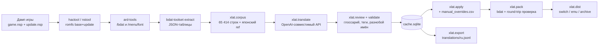

# Русский перевод Xenoblade Chronicles 3

Неофициальный текстовый перевод Xenoblade Chronicles 3 на русский язык с помощью ИИ. Репозиторий содержит не только результат, но и весь конвейер — от распаковки дампа до сборки устанавливаемого пакета.

## Текущая версия: 0.1.0

* История изменений: [CHANGELOG.md](CHANGELOG.md).
* **Скачать перевод**: [последний релиз](../../releases/latest) — в нём три пакета:
  `xc3-ru-switch-vx.x.x.zip` (консоль, Atmosphère), `xc3-ru-emu-vx.x.x.zip` (Ryujinx)
  и `xc3-ru-archive-vx.x.x.zip` (Eden/yuzu, режим правки архива).


## Состояние

| | |
|---|---|
| Переведено строк | 62 949 (2 578 539 символов) |
| Из них диалоги и события | 46 790 |
| Системные таблицы (меню, бой, квесты, предметы) | 16 134 |
| Осталось перевести | 86 видимых строк (см. [docs/KNOWN-ISSUES.md](docs/KNOWN-ISSUES.md)) |
| Шрифты | кириллица в `ascii`, `standard`, `talk` (на базе Noto Sans) |
| Озвучка | оригинальная, перевод только текстовый |
| Язык игры | патчится английский набор (`gb`) — в настройках игры должен стоять English |

Перевод покрывает катсцены, побочные и героические квесты, разговоры в лагере и поле,
меню, боевые подсказки, описания предметов и навыков, имена врагов и локаций.
Финальные титры зашиты в видеофайл и не переводятся; начальные лежат в таблице
`msg_mnu_op_credits` и переведены (с оговоркой — см. известные недочёты).

## Установка

Готовые пакеты собираются в `dist/` (в репозитории их нет — они прикладываются к релизу):

| Пакет | Для чего |
|---|---|
| `xc3-ru-switch` | консоль с Atmosphère: файлы мода на SD, архив игры не трогается |
| `xc3-ru-emu` | Ryujinx: раскладка `mods/contents/<title>/xc3-ru` |
| `xc3-ru-archive` | режим правки архива — для Eden/yuzu, где плагин-лоадер не срабатывает |

Подробная инструкция (что нужно до установки, проверка, удаление) генерируется вместе
с пакетами в `dist/INSTALL.md`. Кратко: нужен апдейт игры **2.2.1** и язык игры
**English**, иначе игра читает непропатченный набор и текст остаётся английским.

## Как это устроено



Ключевая идея — **кэш перевода как источник правды**: `work/t9n/cache.sqlite` хранит
для каждой строки оригинал, перевод, версию промпта, хеш глоссария и модель. Благодаря
этому прогон можно прерывать, догонять только новые строки, дешёво переигрывать
отдельные таблицы и не бояться, что повторная попытка затрёт готовый текст.
Ручные правки живут отдельно (`config/manual_overrides.csv`) и имеют приоритет над
кэшем — машина их никогда не перезаписывает.

## Структура репозитория

| Каталог | Что внутри |
|---|---|
| `config/` | глоссарий, стиль, промпт перевода и редактуры, область перевода, ручные правки, пример конфига API |
| `tools/xlat/` | конвейер перевода на Python: корпус, перевод, редактура, проверки, сборка |
| `tools/ardpack/` | правка `bf3.ard`/`bf3.arh` (Rust) — для режима архива |
| `tools/fontfix/` | вставка кириллицы в `.wifnt` (Rust) |
| `translations/` | публикуемая выжимка переводов (`ru.jsonl`) |
| `assets/` | баннер и исходные шрифты Noto Sans |
| `docs/` | инструкции: правка перевода, работа со шрифтами, известные недочёты |
| `dist/`, `game/`, `work/` | пакеты сборки, дамп игры и промежуточные данные — в git не попадают |

## Сборка из своего дампа

Нужны: Python 3.11+, Rust (для `ardpack`/`fontfix`), свой дамп игры и `prod.keys`
(ключи своей консоли или из своей установки Ryujinx), а также сторонние инструменты —
`hactool` (SciresM), `nstool` (jakcron), `ard-tools` и `bdat-toolset` (roccodev),
`xcnx-file-loader` (roccodev) для режима лоадера, ~80Gb дискового пространства на ПК.

```powershell
# 1) распаковка дампа → work/romfs_*, work/ard_bdat, work/font/extracted
hactool.exe -k $K -t pfs0 --outdir=work\nsp_base   game\game.nsp
hactool.exe -k $K -t pfs0 --outdir=work\nsp_update game\update.nsp
hactool.exe -k $K -t nca --romfsdir=work\romfs_base <base>.nca
nstool.exe  -k $K --tik $TIK --basenca <base>.nca -x work\romfs_update <update>.nca
ard-tools.exe --arh work\romfs_update\1\bf3.arh --ard work\romfs_update\1\bf3.ard `
              extract -o work\ard_bdat /bdat
ard-tools.exe --arh work\romfs_update\1\bf3.arh --ard work\romfs_update\1\bf3.ard `
              extract -o work\font\extracted /menu\font
# 2) bdat → JSON (по каталогу на файл)
bdat-toolset.exe extract <файл>.bdat -o work\bdat_json\<stem> -f json --pretty

# 3) конвейер перевода — из каталога tools
cd tools
python -m xlat.corpus      # JSON-таблицы → work/corpus/corpus.jsonl
python -m xlat.translate   # нужен config/api.json (скопируйте api.example.json)
python -m xlat.review      # необязательно: второй проход редактором поверх готового
python -m xlat.apply       # кэш + ручные правки → work/bdat_json_ru
python -m xlat.pack        # → work/bdat_packed (пакует и сверяет round-trip)
python -m xlat.dist        # → dist/ (switch, emu, archive) + INSTALL.md
python -m xlat.export      # → translations/ru.jsonl (публикуемая выжимка)
```

Шрифты собираются отдельно — см. [docs/fonts-howto.md](docs/fonts-howto.md).
Из чистого клона без прогона модели: `python -m xlat.import` загрузит
`translations/ru.jsonl` в кэш, после чего `apply → pack → dist` соберут мод
из готовых переводов.

## Правка перевода руками

Машинный перевод можно перебить в любой момент — правки лежат в
`config/manual_overrides.csv` и подставляются поверх кэша при сборке:

```powershell
cd tools
python -m xlat.manual find "Хвост ловкого"                      # найти строку
python -m xlat.manual set --src "Dextrous Bunnit Tail" --ru "Хвост баннита"
python -m xlat.manual list                                      # все правки
```

Правила (сохранять разметку и переносы строк, обращение «ты/вы», термины глоссария)
описаны в [docs/EDITING.md](docs/EDITING.md).

## Версионирование

* `VERSION` — версия перевода, `CHANGELOG.md` — что изменилось.
* Имена пакетов и `version.txt` внутри содержат версию; git-тег `v0.1.0` фиксирует
  ровно то состояние строк, из которого собрана версия.
* `translations/ru.jsonl` — выжимка перевода в виде текста: диффы между версиями
  читаются глазами, новые строки не теряются.

## Как помочь

* Нашли ошибку перевода — присылайте `key` строки (виден через `python -m xlat.manual find`)
  и предлагаемый вариант: правку внесём в `config/manual_overrides.csv`.
* Термины и имена — `config/glossary.csv` (`mode=force` закрепляет термин жёстко,
  `suggest` — рекомендует).
* Присылайте правки шрифтов, улучшения валидатора и инструкций.

## Лицензия и правовая часть

* **Код** (`tools/`, скрипты сборки) — MIT, см. [LICENSE](LICENSE).
* **Перевод и текстовые материалы** (`translations/`, `config/`, `docs/`) —
  CC BY-NC-SA 4.0: использование с указанием авторства, некоммерческое,
  производные под той же лицензией, см. [LICENSE-TRANSLATION](LICENSE-TRANSLATION).
* **Шрифты Noto Sans** (`assets/fonts/`) — SIL OFL 1.1.

Это фанатский перевод, не связанный с Nintendo и Monolith Soft. Файлы игры в
репозитории не распространяются: для сборки нужен собственный дамп. Сторонние
инструменты (`hactool`, `nstool`, `bdat-rs`, `ard-tools`, `xcnx-file-loader`)
принадлежат их авторам и имеют собственные лицензии.
